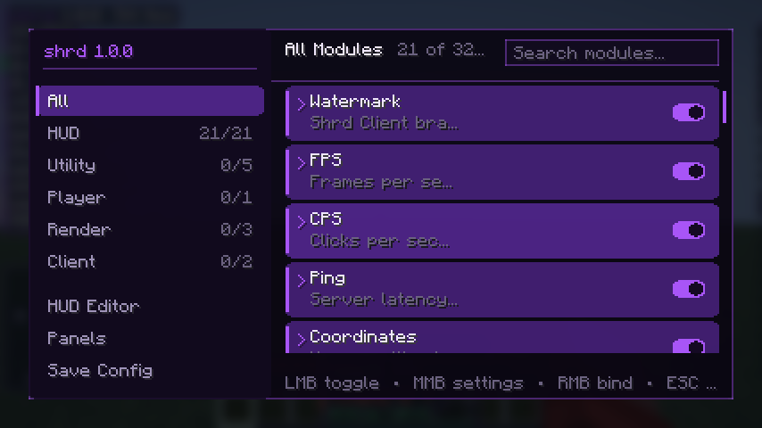
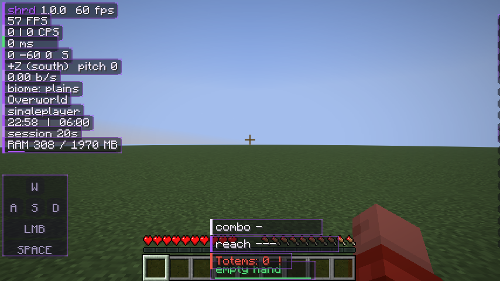
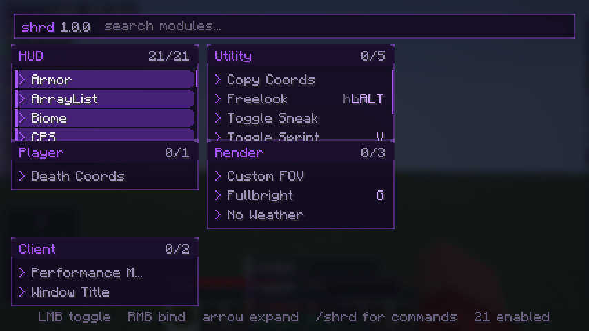
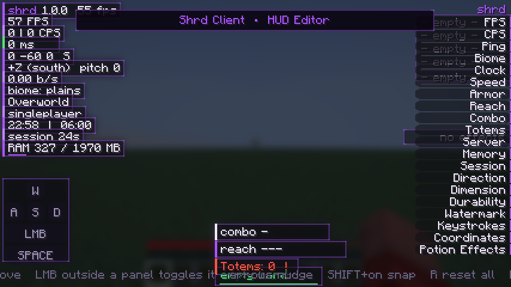
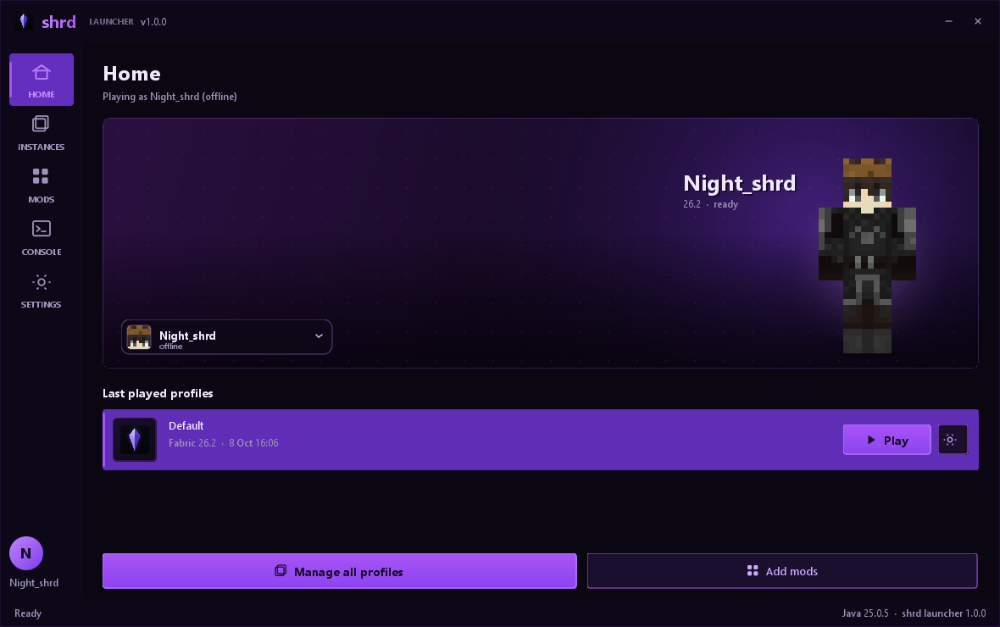
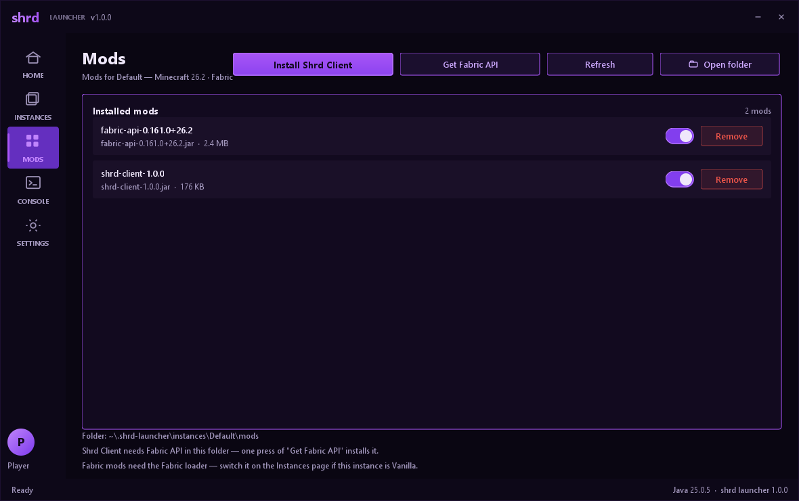
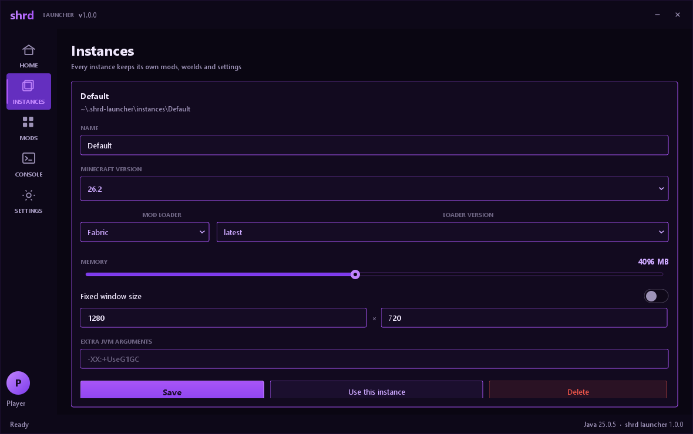
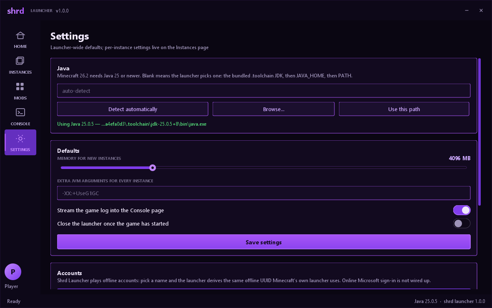
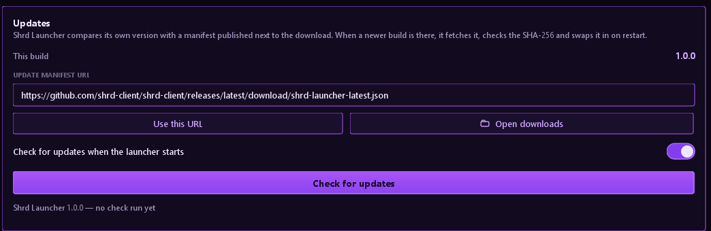
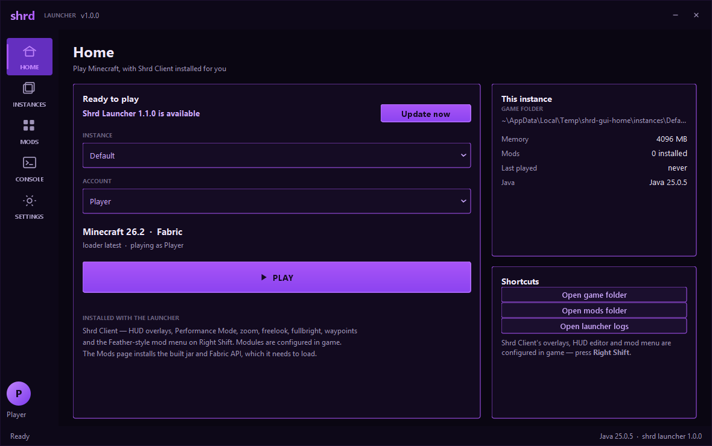

# Shrd Client

A Dawn-style, **server-safe** client mod for Minecraft Java Edition, built from source as a
Fabric mod for **Minecraft 26.2**.

Shrd Client is an information and convenience client: overlays that tell you what is going on,
camera tools that make looking around easier, a Performance Mode for machines that need one, and
a Feather-style mod menu on **Right Shift** to configure all of it. It wears a purple-on-black
theme throughout.
Nothing in this client automates combat, movement or interaction, and nothing tries to defeat
server-side checks — it stays inside what ordinary play allows, which is what makes a client
like this worth using on the servers you actually play on.


## Screenshots

Mod menu — **Right Shift**. Category sidebar, search, a switch per module, keybind chips, and
settings that expand in place:



In-game HUD (overlays stay visible behind menus, like vanilla). Captured with Minecraft's stock
VSync cap in place, which is exactly why the FPS overlay in the corner reads 60 — see
[Performance](#performance):



ClickGUI — one draggable panel per category, settings edited in place:



HUD editor — drag any overlay, disabled ones show as ghost outlines:



## Shrd Launcher

This project ships two things: the in-game client, and **Shrd Launcher**, the desktop app that
installs and runs it. The launcher is real — it resolves a version from Mojang's metadata, merges
Fabric's launch profile, downloads and SHA-1 verifies every library and asset, and starts the game,
exactly the way the official launcher does it. It wears the same black-and-purple identity
as the client, down to the same accent (`#A855F7`).

Home — pick an instance and account, then Play:



Mods — install this project's build straight into an instance, plus the Fabric API it needs:



Instances — a Minecraft version, a loader, its own memory and its own game folder:



Settings — Java, defaults, accounts, where the launcher keeps its files, and updates:



Updates — the version, the manifest it checks, and one button to fetch a new build:



### Downloading it

**[Download Shrd Launcher 1.0.0](https://github.com/Nightshrd-afk/shrd-client/releases/latest)** —
`Shrd Launcher-1.0.0.exe` to install it, or the portable zip to run it without installing. The
release also carries the same installer as an `.msi` and the update manifest the launcher reads.

`bash launcher/build-installer.sh` builds the whole release — a real Windows installer, the same
app as a portable zip, and the manifest the launcher updates itself from:

```bash
bash launcher/build-installer.sh          # all of it; pass portable, msi or exe for just one
# -> dist/Shrd Launcher-1.0.0.exe                 (37 MB) the installer, one file
# -> dist/Shrd Launcher-1.0.0.msi                 (36 MB) the same installer as an MSI
# -> dist/shrd-launcher-1.0.0-windows-x64.zip     (34 MB) portable, nothing to install
# -> dist/shrd-launcher-latest.json               the update manifest
```

**The installer** puts Shrd Launcher in `C:\Program Files\Shrd Launcher`, adds a **Shrd Launcher**
group to the Start Menu with a shortcut in it, and registers itself in **Apps & features**, so it
uninstalls like anything else (`msiexec /x` works too). Installing asks for administrator rights —
that is the cost of Program Files — and the package carries its own Java 25 runtime, so the launcher
itself runs with nothing else installed. Prefer the `.exe` (one file, a wizard); the `.msi` is the
same thing for silent installs and group policy (`msiexec /i "Shrd Launcher-1.0.0.msi" /qn`).

The **game** is a separate matter: Minecraft 26.2 runs on a Java 25 of its own, and the launcher
does not download one. If the machine has none, Home says so (`No Java found`) and
**Settings → Java** takes a path to one; the launcher looks in its own `javaPath`, a `.toolchain`
folder beside it, `JAVA_HOME`, then `PATH`.

**The zip** is that same app unpacked, for a machine where nobody has admin rights: unzip it
anywhere you can write to, double-click `Shrd Launcher.exe`, and deleting the folder uninstalls it.

Nothing in either download is machine-specific, so sharing it is just uploading the file (GitHub
release, Drive, Discord): whoever receives it needs neither this project nor a JDK to open the
launcher — only a Java 25 somewhere for the game itself.

Building the installers needs the [WiX Toolset](https://github.com/wixtoolset/wix3); the script
downloads it into `.toolchain/wix-3.14.1` (41 MB, no admin needed) if it is not already there. The
application icon is drawn rather than shipped as a bitmap — [tools/make-icon.java](tools/make-icon.java)
renders the shrd gem at every size Windows asks for and writes the multi-size `.ico` by hand.

What is in it:

| | |
|---|---|
| `Shrd Launcher.exe` | the app; the shrd gem is its icon in Explorer, the taskbar and Apps & features |
| `runtime/` | a trimmed Java 25 runtime (~50 MB), so Java does not have to be installed |
| `app/shrd-launcher-1.0.0.jar` | the launcher itself, with Gson inside |
| `app/mods/shrd-client-1.0.0.jar` | the client mod, so **Install Shrd Client** works with no build tools |
| `INSTALL.txt` | the three steps, plus where your files live (zip only) |

### Updating it

Shrd Launcher updates itself. On start — and whenever the button in **Settings → Updates** is
pressed — it fetches a small manifest and compares versions; when the published one is newer it
offers the download on the Home page:



Accepting it downloads the published zip, checks its **SHA-256** against the manifest (a mismatch is
thrown away, not installed), unpacks it, and then — because a running program cannot replace its own
files on Windows — writes a short script that waits for the launcher to exit, copies the new build
over the installation and starts it again. The copy removes files the new release no longer has, so
the folder ends up as the new version rather than a pile of both.

The manifest is one small file:

```json
{
  "version": "1.0.0",
  "file": "shrd-launcher-1.0.0-windows-x64.zip",
  "url": "",
  "sha256": "68734e45…",
  "size": 35209788,
  "notes": "Shrd Launcher 1.0.0"
}
```

`url` may be left empty, in which case the archive is fetched from next to the manifest — so
publishing a release is "put the zip and the json in one folder and serve it". The manifest URL is a
setting (Settings → Updates) and defaults to a GitHub release named `shrd-launcher-latest.json`.

Two things worth knowing: updating an install that lives in **Program Files** needs administrator
rights, so Windows asks once (the swap re-launches itself elevated when it has to); a portable copy
in a writable folder updates with no prompt at all.

Testing an update without publishing anything:

```bash
SHRD_VERSION=1.1.0 SHRD_OUT=dist-test bash launcher/build-installer.sh portable
java tools/update-server.java dist-test 8791
"dist/Shrd Launcher/Shrd Launcher.exe" --manifest http://127.0.0.1:8791/shrd-launcher-latest.json --check-update
```

[tools/update-server.java](tools/update-server.java) is a throwaway static file server for exactly that.

### Publishing a release

```bash
bash launcher/publish-release.sh          # the version comes from gradle.properties
```

[launcher/publish-release.sh](launcher/publish-release.sh) builds all four files, tags the version,
creates the GitHub release and uploads the installer, the MSI, the portable zip and the manifest —
then checks what it published instead of trusting the upload. It fetches the manifest and the zip
back from the release's own URL, compares their hashes with the files it just built, and finishes by
running the launcher's `--check-update` against that live URL.

The URL every copy of the launcher looks for updates at is baked into
[Updater.DEFAULT_MANIFEST_URL](launcher/src/main/java/dev/shrd/launcher/update/Updater.java), so the
script refuses to publish from a repository that does not match it: it is
`https://github.com/Nightshrd-afk/shrd-client/releases/latest/download/shrd-launcher-latest.json`.
For the first release the repository has to exist once:

```bash
gh repo create Nightshrd-afk/shrd-client --public --source=. --remote=origin --push
```

Assets are uploaded under their own names, so `releases/latest/download/<name>` — the shape the
baked URL uses — always resolves to the newest release, and the launcher needs no API token to read
it. Bumping `version` in `gradle.properties` is the whole release process: the tag, the artifacts
and the version the app reports all come from it.

Two details the script handles for you, because both cost a failed release to learn: GitHub turns
the spaces in `Shrd Launcher-1.0.0.exe` into dots (`Shrd.Launcher-1.0.0.exe`) in the download URL,
and re-publishing a version that already has a tag updates the release in place without moving the
tag. So download URLs use the dotted name, and a real fix ships as a new version rather than a
re-upload of the old one.

The current release: https://github.com/Nightshrd-afk/shrd-client/releases/tag/v1.0.0

### What it does

- **Home** — a banner with your own skin standing in it (fetched by name, or from the signed-in
  profile), the account chip, and a Play button on every profile that turns into Stop. The banner
  background is yours: Settings → Appearance takes any PNG or JPG and copies it into the launcher's
  folder. Without one it is the purple gradient.
- **Accounts** — offline names, or **Microsoft sign-in** for servers that verify you.
- **Instances** — create, edit and delete instances. Each one gets its own folder, mods, worlds and
  settings, with a Minecraft version (read live from Mojang), a mod loader, memory, an optional
  fixed window size and extra JVM arguments.
- **Mods** — the instance's `mods` folder as a list: enable or disable a mod (a switch, which is
  Fabric's `.disabled` convention), delete it, install **Shrd Client** from this project's build
  output, or fetch **Fabric API** for the instance's Minecraft version from Modrinth.
- **Servers** — a free Minecraft server on this PC: it downloads Mojang's server jar for the
  instance's version, writes the config, starts and stops it, and shows the server's console. The
  address it prints is what you and your friends join.
- **Console** — the launcher's own steps and the game's output, live, colour-coded, with the game's
  log file one press away.
- **Settings** — Java detection (the bundled `.toolchain` JDK, then `JAVA_HOME`, then `PATH`),
  default memory and JVM arguments, the Home background, offline accounts (pick a name; the launcher
  derives the same offline UUID Minecraft's own launcher uses), and Microsoft sign-in.

Everything lives in `~/.shrd-launcher`: shared `libraries`, `assets` and `versions` caches, one
folder per instance under `instances/`, and launcher logs under `logs/`. Nothing is written into the
project folder except the build output.

### Running it from source

```bash
cd launcher
../.toolchain/gradle-9.8.2/bin/gradle build      # or: gradle build
java -jar build/libs/shrd-launcher-1.0.0.jar      # opens the launcher window
```

That needs Java 21+ on the machine, which is why the packaged build above exists.

On Windows, `launcher\run-launcher.bat` runs the built jar with the bundled JDK. The launcher needs
Java 21 or newer to run; the game itself needs Java 25, which 26.2 declares.

It also takes flags, which is how the launcher's own verification drives it:

```
--install-mods [instance]      copy the built Shrd Client jar + Fabric API into an instance
--prepare [instance]           resolve and download everything, without launching
--launch [instance]            start the game
--wait <seconds>               with --launch: wait this long for the game to exit
--versions                     list Minecraft releases from Mojang
--shot <page>[,<file.png>]     render a page to a PNG (used for the theme check)
--home <dir>                   use a different data folder
--version                      print the version and where this copy is installed
--check-update                 compare this build with the update manifest
--update [--apply]             download an update; --apply swaps it in and restarts
--manifest <url>               use this manifest for the check/update instead of the saved one
```

### Free server hosting

**Servers → Start server** runs a real Minecraft server for the active instance, for free, with no
account and no queue. The jar comes from Mojang's own version manifest for that exact version, so
the client and the server can never disagree; the world, `server.properties` and logs live under
`~/.shrd-launcher/servers/<instance>` so they can be backed up or moved.

Two things it is honest about:

- **It runs on this PC.** The server lives as long as the machine and the launcher do. That is the
trade for not paying anyone: Aternos, Minehut and Falixnodes host for free, but they sleep when
empty, queue you at busy times, and exist only inside their own website — none of them offers an API
a launcher could create a server with, so the launcher cannot drive them.
- **`online-mode` follows the account you picked.** Signed in with Microsoft → the server verifies
players. An offline account → the server runs `online-mode=false` (the console says so, in red), and
anyone who knows the address can join under any name. That is fine for friends on your own network,
and it is why sign-in matters if you open it up.

Friends on the same network use the address shown as *Join from your network*. From outside, the
cheapest free route is a tunnel such as [playit.gg](https://playit.gg/) — no port forwarding, and it
keeps working as long as this PC is on.

### Microsoft sign-in, and what it still needs

Servers that verify you — Donut SMP and most public servers — need a real Microsoft session.
**Settings → Microsoft sign-in** runs the same chain the official launcher does: device code →
Microsoft token → Xbox Live → XSTS → Minecraft services → profile. The Minecraft token it ends with
is handed to the game as `--access-token`, so the server accepts the session; the profile also
supplies the real name, UUID and skin.

It needs one thing this project cannot ship: a free Azure application (client) id. That id is
public by design — it travels in the URL — but it belongs to whoever registers the app:

1. portal.azure.com → **App registrations** → **New registration** (any name, account type
   "Personal Microsoft accounts")
2. **Authentication** → **Allow public client flows** → **Yes**
3. Copy the **Application (client) ID** from the overview page into Settings

Without that id, offline accounts still work exactly as before: singleplayer and LAN, and servers
that do not verify sessions. The launcher says so rather than pretending: pressing Sign in with no
id explains the three steps above.

## Install

**With Shrd Launcher:** press Play on the Home page. It installs Fabric, the client and Fabric API
into an instance it owns, so nothing in `.minecraft` has to be touched.

**By hand:**

1. Install **Fabric Loader 0.20.1+** for **Minecraft 26.2** (the [Fabric installer](https://fabricmc.net/use/installer/) does this).
2. Drop [Fabric API](https://modrinth.com/mod/fabric-api) `0.161.0+26.2` into `.minecraft/mods`.
3. Drop `shrd-client-1.0.0.jar` into `.minecraft/mods`.
4. Launch the Fabric 26.2 profile. Java 25 is required — 26.2 ships a Java 25 runtime.

## Controls

| Input | Action |
|---|---|
| **Right Shift** | Open / close the Shrd Client mod menu |
| **C** (hold) | Zoom |
| **Left Alt** (hold) | Freelook — look around, release to snap back |
| **G** | Fullbright |
| **V** | Toggle Sprint |
| **F6** | Copy coordinates to clipboard |
| `/shrd` | Client commands (never sent to the server) |

Every one of those keybinds can be changed: right click a module in the GUI to bind a key,
or use `/shrd bind <module> <key>`.

## Mod menu

**Right Shift** opens one window over the game: a category sidebar on the left, a search field in
the header, and a list of modules in the middle. Each row carries the module's name and
one-line description, its keybind chip, and a toggle switch on the right.

- **Left click** a row to toggle it. **Left click the chevron** (or middle click) to expand its
  settings inline. **Right click** to bind a key.
- Settings are edited where they are listed: switches toggle, numbers drag as sliders, modes
  cycle, colours cycle through a palette, text fields type directly, keybind rows capture the next
  key or mouse button you press.
- The search field filters across every category at once — searching from `All` finds a module
  wherever it lives.
- Sidebar counters show `enabled/total` per category, and the footer row has **HUD Editor**, the
  **Panels** layout, and **Save Config**.
- The scroll wheel scrolls the list; the scrollbar sits on the right edge.

### Panel layout

`/shrd panels` opens the older draggable-panel layout, which is still fully supported: one panel
per category you can drag anywhere, left click to toggle, right click to bind, and an arrow to
expand settings in place. It is handy when you want several categories visible side by side.

## HUD editor

`/shrd hud` (or from the GUI) opens the visual editor. Drag any overlay where you want it,
right click to switch one off, arrow keys nudge, `G` toggles grid snap, `R` re-stacks them.
Positions are stored as screen fractions, so they survive window resizes.

## What is in the box

**Overlays (HUD)** — Watermark, FPS, CPS, Ping, Coordinates, Direction, Speed, Biome, Dimension,
Server, Clock, Session, Memory, Keystrokes, Armor, Potion Effects, Durability, Totems, Reach,
Combo, ArrayList.

**Utility** — Zoom, Freelook, Toggle Sprint, Toggle Sneak, Copy Coords.

**Render** — Fullbright, No Weather, Custom FOV.

**Player** — Death Coords, with history via `/shrd deaths`.

**Client** — Performance Mode, Window Title branding.

## Commands

```
/shrd                        status
/shrd gui                    open the mod menu (same as Right Shift)
/shrd panels                 open the draggable panel layout
/shrd hud                    open the HUD editor
/shrd modules                list every module and whether it is on
/shrd toggle <name>          toggle a module by name
/shrd bind <module> <key>    bind a key (c, f6, lshift, mouse1, none, ...)
/shrd coords                 copy your coordinates
/shrd deaths                 list recorded deaths
/shrd search <text>          search module names and descriptions
/shrd config save|load|path  manage the config file
```

## Configuration

Everything is saved to `config/shrd-client/config.json` inside your Minecraft directory:
module toggles, keybinds, every setting value and every HUD position. Saved on exit, GUI close,
HUD editor close, and `/shrd config save`.

## Building from source

```bash
./gradlew build          # Linux / macOS
build.bat                # Windows, uses ./.toolchain or JAVA_HOME
```

The output jar lands in `build/libs/shrd-client-1.0.0.jar`. `./gradlew runClient` launches a
development client with the mod loaded, which is the fastest way to test a change.

Requires **JDK 25** and **Gradle 9.8.2** (the wrapper handles Gradle). `build.bat` and
`run-client.bat` automatically use the `.toolchain` folder if one exists.

## Performance

Performance is measured here, not asserted: `./gradlew runGametest` joins a world and
benchmarks the frame rate in several configurations, printing one `SHRD-BENCH` line per phase
(the raw lines are in [docs/VERIFICATION.md](docs/VERIFICATION.md)).

Numbers below are from this machine (Intel UHD integrated graphics, dev client, the gametest
window at 854x480, 16 chunk render distance, fancy graphics). FPS is the number Minecraft's own
F3 counter reports, median over a 20 second window:

| Configuration | FPS (median, across five runs) |
|---|---|
| **Stock settings — VSync on, 120 FPS limit** | **60** (identical in every run) |
| Caps removed, all 21 overlays on | 163-365 |
| Caps removed, overlays off | 327-513 |
| Caps removed, Performance Mode on | 202-331 |
| Caps removed, Performance Mode with 8 chunks | 220-375 |

Those ranges are wide because this machine drifts a lot between runs: the *same* configuration
measured 163 FPS in one window and 365 FPS in another. That is why every number here is a median
over 20 seconds and why ranges are quoted instead of a single figure.

**What stops you reaching 200 FPS is the frame rate cap, not the client.** A stock install runs
with VSync on and Minecraft's 120 FPS frame limit. With those in place the counter read exactly
60.0 FPS for the whole 20 second window, in every run — while the client was doing hundreds of FPS
of frame work. VSync locks the presented frame rate to the monitor's refresh rate, which is 60 on
most monitors. No amount of optimisation on the client side gets past that; removing the caps is
what took the same scene from 60 into the 200-500 FPS range.

All 21 overlays together cost well under a millisecond per frame (measured between 6% and 40% of
the frame rate across five runs — at ~300 FPS the run-to-run noise in world rendering is larger
than the effect), so with the caps off, overlays are not what stands between you and 200+ FPS.

### Performance Mode

The `Performance Mode` module (Client category) applies the settings that actually move the frame
rate, in one switch, and restores every one of them when you switch it off:

- **Remove frame limit** — VSync off and the frame limit to Minecraft's maximum. This is the
  switch that matters; it is what removes the 60 FPS wall.
- **Visual downgrade** — fast graphics: no clouds, minimal particles, no smooth lighting, no
  entity shadows, no biome blend, no chunk fade-in, no vignette, fastest leaves, no texture
  filtering.
- **No view bobbing**.
- **Reduce render distance** (optional, off by default) — clamps render and simulation distance
  to 8 chunks. The biggest lever of all, and the one that also changes how far you can see.

At 854x480 the graphics switches measured no difference (318 vs 329 FPS in the final run, inside
the run-to-run noise)
because that machine is not GPU-bound at that window size. They are the levers that count at
1080p, on weaker GPUs, and with large render distances. Every measurement here is from the
gametest window: that harness window is not resizable, so no 1080p figure is quoted rather than
quoting a mislabelled one.

### Tuning it yourself

1. **Turn VSync off** (Options → Video → VSync) and set **Max Framerate** to unlimited. Vanilla
   defaults to 120, and VSync locks you to your monitor's refresh rate.
2. Or enable **Performance Mode** and let it do both at once.
3. Still short of your target? Increase the Performance Mode distance clamp, or lower render
   distance. Resolution and render distance dominate everything the client itself does.

### What Shrd Client does with that frame

Overlay text, lists and measurements are refreshed once per tick rather than once per frame, panel
fills are batched into the rows that actually need insetting, and the enabled-overlay list is only
rebuilt when a module is toggled. That work used to happen several times per frame per overlay.
This is a description of what the code now does, not an A/B measurement — the numbers above
measure the client as it is now, and the before/after of that specific change was not benchmarked
on a separate build.

## Verification

This client is checked against a real Minecraft, not just compiled:

```bash
./gradlew build          # compiles, remaps and packages the mod jar
./gradlew runClient      # boots a dev client; log shows "Shrd Client v1.0.0 loaded — 32 modules"
./gradlew runGametest    # joins a world, screenshots the HUD/ClickGUI/HUD editor, then benchmarks FPS

java tools/UiCheck.java run/screenshots/0000_shrd-hud.png        accent,text         30
java tools/UiCheck.java run/screenshots/0001_shrd-modmenu.png    accent,text,textDim 30
java tools/UiCheck.java run/screenshots/0002_shrd-clickgui.png   accent,text,textDim 30
java tools/UiCheck.java run/screenshots/0003_shrd-hud-editor.png accent,text         30
```

`runGametest` also drives the mod menu through its own input handlers — asking a row where it is,
clicking the middle of it, and pressing ESC — and fails the run if the module did not toggle or the
menu did not close. It then prints the frame rate benchmark described under
[Performance](#performance), one `SHRD-BENCH` line per configuration.

`runGametest` uses Fabric's client gametest API to drive the game without any OS input, and
`tools/UiCheck.java` asserts that Shrd Client's own opaque theme colours are on screen — which
can only happen if the overlays and screens really rendered. All four checks pass on this build;
see [docs/VERIFICATION.md](docs/VERIFICATION.md) for the numbers, for the real bugs this found
and fixed, and for what is explicitly *not* verified (zoom/freelook behaviour needs a human eye).

The launcher is checked the same way, end to end, by one script:

```bash
bash tools/verify-launcher.sh            # install the mod, resolve, download, launch, assert
```

It installs the mod through the launcher, resolves and downloads the whole launch set, then starts
a real Minecraft and checks what the game reported: Fabric booted, `shrdclient` is in the mod list,
the client's entrypoint ran, the game reached the menu, and the console captured exactly one copy of
the log. The packaged download is checked the same way — its own `Shrd Launcher.exe` is run against
a fresh data folder to install the mod it carries and fetch Fabric API over HTTPS. The installer and
the updater are checked too: the MSI's own tables are read back with `tools/msi-report.ps1`, and a
published 1.1.0 build is served locally with `tools/update-server.java` so a real 1.0.0 copy can
find it, verify its SHA-256, swap itself and come back as 1.1.0 — including the case where the
manifest's hash is wrong and the update must be refused. The five launcher pages are rendered to PNG and asserted with `UiCheck` as well:

```bash
java <jdk>/bin/java -jar launcher/build/libs/shrd-launcher-1.0.0.jar --shot home,docs/screenshots/launcher-home.png
java tools/UiCheck.java docs/screenshots/launcher-home.png accent,text 40
```

Helper scripts in `tools/`: `verify-ui.ps1` (focus the game, optionally send a key or chat
command, capture the window), `key-tap.ps1` (hold a key long enough for a tick-based poll),
`generate-icon.java` (regenerate the mod icon), `make-icon.java` (draw the launcher's icon and its
`.ico`), `msi-report.ps1` (read a built installer back) and `update-server.java` (serve a release
folder so the updater can be tested offline).

## Honest notes about the implementation

- **No cheats, by design.** There is no autoclicker, reach extension, trigger bot, kill aura,
  auto-eat, auto-totem, mace/pearl automation, block or player ESP, or anything else that plays
  the game for you, and no movement module. Reach and Combo only *observe* your own vanilla
  attacks to display numbers. If you want a module from a client that has those, that is a
  different product: this one is meant to be usable on the servers you actually play on.
- **Zoom** is applied through the vanilla FOV option (eased each tick) rather than a render
  mixin. It is exact and survives graphics changes, but it animates in FOV steps rather than
  smoothly interpolating at frame rate.
- **Freelook** rotates your view and restores it on release, optionally in third person.
  It is not Dawn's camera-only decoupling: while you are looking around, your character's
  facing follows the camera. It is still a pure client change with no server side effects.
- **Fullbright** raises the lightmap floor, so dark areas become readable rather than blown out.
- 26.2 is a major renderer and input refactor (render-state extraction, `GuiGraphicsExtractor`,
  `KeyEvent`/`MouseButtonEvent` records), so this is written against the real 26.2 API surface
  rather than translated from an older tutorial.
- **Frame rate numbers are measured on this development machine at 854x480**, the size the test
  harness runs at, and that window cannot be resized. At 1080p expect lower numbers; the relative
  costs (overlays below a millisecond per frame, the frame rate cap dominating) are what carry over.
- The jar contains a small `fabric-client-gametest` entrypoint used by the project's own UI test.
  Fabric only runs those entrypoints when the `fabric.client.gametest` property is set, which only
  the `runGametest` configuration does, so it is inert in a normal game.

## Layout

```
src/main/java/dev/shrd/client/
  ShrdClient.java          entrypoint: modules, keybinds, events, config lifecycle
  ShrdHudRenderer.java     the single HUD hook that draws every overlay
  core/                    Module, HudModule, ModuleManager, settings, shared state
  config/                  ConfigManager (Gson)
  gui/                     ModMenuScreen (Feather-style), ClickGuiScreen (panels), HudEditorScreen, Theme
  modules/hud|utility|render|player|client/   the modules themselves
  command/                 /shrd command tree
  mixin/                   the two render mixins (lightmap, weather)
  util/                    renderer, key names, player queries, combat + CPS tracking
  gametest/                automated UI test (runs only under runGametest)

launcher/
  build.gradle             the launcher's own Gradle project (Gson, single runnable jar)
  src/main/java/dev/shrd/launcher/
    ShrdLauncher.java      main; opens the window, or runs one of the CLI modes
    LaunchService.java     "Play was pressed" to "the game is running", used by the GUI and the CLI
    LauncherConfig.java    accounts, instances and defaults, saved as JSON
    ModsManager.java       the mods folder: list, enable/disable, install the client build + Fabric API
    Cli.java               --install-mods / --prepare / --launch / --versions
    launch/                the launch engine: Mojang + Fabric metadata, rule-based library
                           resolution, parallel verified downloads, assets, arguments, process
    ui/                    Theme, hand-painted widgets, the window and the five pages

tools/                     verification + asset helpers (UiCheck, verify-ui.ps1, key-tap.ps1,
                           verify-launcher.sh)
docs/                      verification record and screenshots
```

## Roadmap

- Waypoint markers with world-space labels and distance readouts.
- Chat timestamps and copy-on-click for chat lines.
- Per-category accent colours and a theme editor.
- Optional ModMenu integration for the mod list entry.
